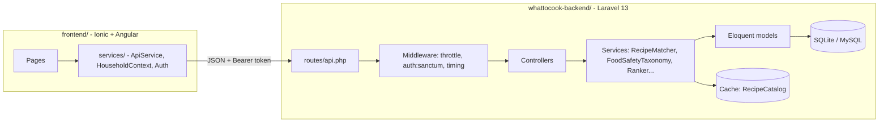
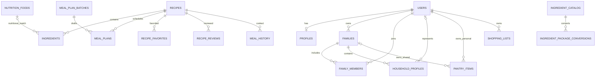

# Architecture and business rules

**Read this on day 2.** It tells you what the parts are and which rules the code must never break.

## System shape

| Layer | Location | Rule |
| --- | --- | --- |
| Pages | `frontend/src/app/<page>/` | Own the template and view state only |
| Frontend services | `frontend/src/app/services/` | All HTTP goes through `ApiService` |
| Routes | `whattocook-backend/routes/api.php` | One place listing every endpoint |
| Controllers | `app/Http/Controllers/` | Validate, authorise, call services, shape JSON |
| Services | `app/Services/` | Business rules; no HTTP knowledge |
| Models | `app/Models/` | Relations and casts |

## Scope: the rule behind most code

| Context | Safety profiles used | Pantry used | Shopping list and cooking affect |
| --- | --- | --- | --- |
| Personal | the signed-in user's profile | rows with that `user_id` and **no** `family_id` | personal data only |
| Family | the selected household diner profiles | rows with that `family_id` | the shared family data only |

A request with `family_id` is allowed only if the caller is an *accepted* `family_members` row. That check lives in one place: `AuthorisesFamilyAccess::canUseFamily` (see [12-api-reference.md](12-api-reference.md), "Shared controller code").

## Data model

A *family member* is a registered account. A *household profile* is any diner, including a child with no login. Details and indexes: [10-database-and-indexes.md](10-database-and-indexes.md).

## Business rules (keep these true)

**Ingredient intake.** `IngredientCatalogService` normalises case and whitespace and resolves only approved catalogue rows: exact name is *accepted*; alias or simple plural is *suggested* (user must confirm); otherwise *rejected* and nothing is saved. Barcode, voice and receipt input produce editable candidates; nothing is saved automatically.

**Matching and units.** `RecipeMatcher` sums compatible pantry lots in the recipe's unit: g/kg and mL/L convert; fractions like `1/2` parse; incompatible units (packs vs grams) are never guessed and become *Needs review* until the user confirms a scoped package conversion. See [11-recipe-matching-and-caching.md](11-recipe-matching-and-caching.md).

**Safety.** `FoodSafetyTaxonomy` is word-aware (vegan excludes "egg" but not "eggplant"). Allergies and dietary exclusions apply for every selected diner. With a child under about 6 selected, recipes with alcohol or `siling labuyo` are excluded.

**Age-aware planning.** `ChildMealPlanner` derives the age band from the birth date on the meal date, never from client input: 0-5 months excluded; 6-11 months 1/4 serving; 12-23 months 1/2; 2-5 years 0.65. It is planning support with a medical disclaimer, not feeding advice.

**Ranking.** `DeterministicMealRanker` scores nutrition, pantry match, soon-to-expire items, time fit, likes/dislikes and repeat penalties. Ties break by recipe id, so output is reproducible. Each meal exposes `why_chosen`.

**Nutrition.** `RecipeNutritionService` converts quantities to grams, links ingredients to cached USDA `nutrition_foods` (per 100 g) and reports `is_complete=false` with reasons when a link or conversion is missing. The UI must show gaps, not imply a complete total.

**Lifecycle.** Draft, review, save, preflight, cook. See [13-meal-planning-lifecycle.md](13-meal-planning-lifecycle.md).

## Backend file map (read in this order)

1. `routes/api.php` - the whole API surface.
2. `app/Models/*` - relations.
3. `app/Services/FoodSafetyTaxonomy.php`, `RecipeMatcher.php`, `IngredientCatalogService.php`.
4. `app/Http/Controllers/Concerns/*` (the two shared traits: family access and household planning helpers), then `PantryController.php`, `RecipeController.php` (simplest flows).
5. `MealPlanBatchController.php`, `DeterministicMealRanker.php`, `ChildMealPlanner.php`.
6. `MealPlanController.php` (cooking and deduction), `ShoppingListController.php`, `ConfirmedPurchaseService.php`.
7. `PantryFreshnessService.php` and `app/Console/Commands/RefreshPantryFreshness.php` (daily freshness status).
8. Admin: `AdminAuthController`, `AdminRecipeController`, `resources/views/admin/*` (a Blade recipe manager, separate from the app).

## Diagrams

Use case, class, sequence and activity diagrams from the original design live in [uml/](uml/) (`use-case.md`, `class-diagram.md`, `sequence-diagram.md`, `activity-diagram.md`, `happy-path.md`). They describe intent; where they disagree with the code or these docs, the code wins.
