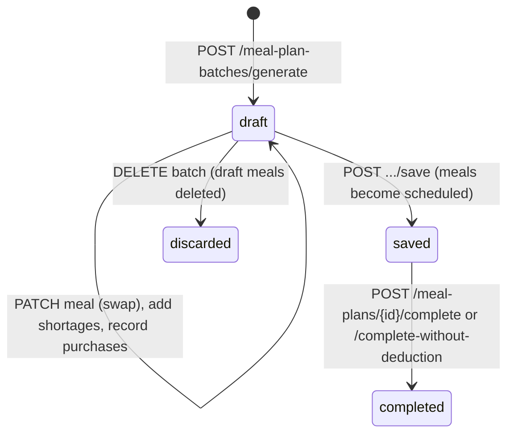

# Meal-planning lifecycle

**Read this on day 4.** It is the core user journey: generate, review, save, cook, history.

## Read in this order

1. `MealPlanBatchController::generate` (draft creation).
2. `Services/DeterministicMealRanker.php`, `Services/ChildMealPlanner.php`.
3. `MealPlanBatchController::show`, `summary`, `updateMeal`, `save`, `discard`.
4. `MealPlanController::preflight`, `complete`, `completeWithoutDeduction`.
5. Frontend: `plan-setup`, `plan-review`, `meal-details`, `cooking` pages.

## State machine



Two status fields:

| Entity | Values |
| --- | --- |
| `meal_plan_batches.status` | `draft`, `saved`, `discarded` |
| `meal_plans.status` | `draft`, `scheduled`, `completed` |

Drafts are invisible on the calendar. Completed meals are immutable.

## Step by step

**1. Generate** (`POST /meal-plan-batches/generate`). Validates the range, meal types, diners, time budget, leftover strategy and per-day attendance. In one transaction it creates a draft batch, then for each day:

```text
roster for that day's diners
  -> ChildMealPlanner (age band and portions from birth date on that day)
  -> DeterministicMealRanker::rank(catalogue, profiles, pantry, history, options, alreadyChosen, date)
       1. drop unsafe recipes (allergy, diet, young-child rules)
       2. drop over-budget recipes if time preference is strict
       3. score: pantry match, expiring items, nutrition, likes/dislikes, repeat penalty
       4. sort by score, then recipe id
  -> create a draft meal_plan with selection_reason (why_chosen)
```

If no recipe is safe for a day, the request fails with 422 and names the date.

**2. Review** (`GET /meal-plan-batches/{id}`). Returns drafts, a summary (`ready_count`, per-ingredient `ready | low_stock | missing | needs_review`), scheduling conflicts and personal-diner conflicts. Draft meals can be swapped (`PATCH`). Shortages go to the shopping list; purchases go to the pantry and the summary is recomputed.

**3. Save** (`POST .../save`). Conflicts with already scheduled meals need an explicit `conflict_action`: `keep_existing` or `replace_conflicting`. Drafts then become `scheduled`.

**4. Preflight** (`GET /meal-plans/{id}/preflight`). Same `RecipeMatcher` as the planner, against the pantry of the meal's scope. Returns `can_cook_from_pantry`.

**5. Cook** (`POST /meal-plans/{id}/complete`). In a transaction: re-check readiness, deduct from compatible pantry lots using the matcher's reverse conversion, mark `completed`, write one `meal_history` row. Alternatively `complete-without-deduction` writes history only.

## Rules to preserve

- Safety exclusion happens before any scoring.
- A draft never changes the pantry. Only cooking and recorded purchases do.
- Deduction touches only the meal's own scope (personal or family).
- Deduction and preflight must use the same matcher so what the user was shown is what is removed.

## Removed legacy endpoint

`POST /meal-plans/generate` created scheduled meals directly, bypassing review. It has been deleted along with `MealPlanController::generate` and its separate ranking code. If you see an old client calling it, switch it to the batch flow above.

## Tests that document this

`MealPlanBatchApiTest`, `MealPlanCookingPreflightApiTest`, `MealPlanningApiTest`, `Unit/DeterministicMealRankerTest`, `ConfirmedPurchaseApiTest`.
